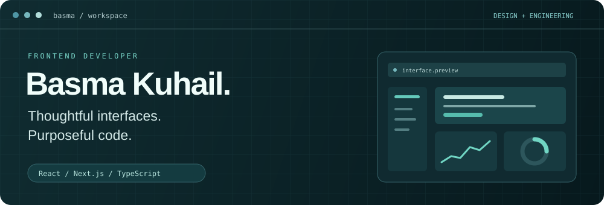

  <a href="#selected-work">Selected work</a> &nbsp; / &nbsp;
  <a href="#toolkit">Toolkit</a> &nbsp; / &nbsp;
  <a href="#how-i-build">How I build</a> &nbsp; / &nbsp;
  <a href="#contribution-playground">Playground</a> &nbsp; / &nbsp;
  <a href="https://www.linkedin.com/in/basma-kuhail-55a77a1a3/">LinkedIn ↗</a>

## Hi, I'm Basma.

I'm a **software engineer and frontend developer** building web applications with **React, Next.js, and TypeScript**. I enjoy turning complex workflows into interfaces that feel clear, responsive, and easy to use.

My work spans healthcare, education, and AI chat — connecting thoughtful UI with authentication, APIs, and persistent data.

> **What interests me:** the details between a good-looking screen and a useful product.

 

`01 / PROJECT EXPLORER`
## Selected work

### Shifaa · Healthcare workflows, connected
A healthcare platform bringing medicine discovery, pharmacy workflows, and administration into one interface.

**Frontend focus:** medicine search, role-specific dashboards, API integration, and Arabic/English localisation.

`Next.js` `React` `TypeScript` `Tailwind CSS` `Axios`

**[Explore the code ↗](https://github.com/BasmaKuhail/Shifaa)** · *Active development*

<strong>Inside the project</strong> — search, roles &amp; localisation

- Medicine search and medication request interfaces.
- Separate workflows for patients, pharmacists, pharmacies, and administrators.
- Pharmacy invitations, registration, and management screens.
- Shared API services and reusable interface components.
- Arabic/English localisation with React-i18next and Next-i18next.

---

### Unlock Your English · A clearer learning journey
An English learning platform for a free educational initiative, with separate learner and administrator experiences.

**Frontend focus:** student management, level access, protected routes, and guided progression.

`Next.js 16` `React 19` `TypeScript` `Firebase`

**[Explore the code ↗](https://github.com/BasmaKuhail/unlock-your-english)** · *Active development*

<strong>Inside the project</strong> — learners, levels &amp; access

- Student search, filtering, profile editing, and active/frozen account states.
- Administrator-managed learner accounts and level access.
- Server-verified admin claims and HttpOnly session cookies.
- Separate browser Firebase and server-only Firebase Admin integration.
- Ongoing work on learning content, level management, and production testing.

---

### BrainBot · Conversations that keep flowing
An experimental AI chat application exploring streaming responses, persistent conversations, and practical AI integrations.

**Frontend focus:** streaming chat UI, conversation management, attachments, and light/dark themes.

`Next.js` `TypeScript` `Tailwind CSS` `Supabase` `OpenRouter`

**[Try the demo ↗](https://basmakuhail-brain-bot.vercel.app)** · **[Explore the code ↗](https://github.com/BasmaKuhail/Chat-Bot)**

<strong>Inside the project</strong> — streaming, history &amp; attachments

- Responses appear progressively as the AI generates them.
- Search, rename, delete, and revisit saved conversations.
- User authentication and persistent chat history.
- File/image attachments and conversation exports.
- Deliberate context and attachment limits to manage API costs.

*This is an experimental demo with usage limits.*

 

`02 / THE TOOLKIT`
## Toolkit

| Area | Technologies |
| :--- | :--- |
| **Interface engineering** | React · Next.js · TypeScript · JavaScript |
| **Styling & interaction** | Tailwind CSS · Material UI · Framer Motion |
| **Data & integration** | REST APIs · Axios · Firebase · Supabase |
| **Backend foundations** | Java · Spring Boot · MySQL · SQL |
| **Workflow** | Git · GitHub · Vercel |

 

`03 / BEHIND THE INTERFACE`
## How I build

**Make the journey clear.** Give users a clear next step, with useful feedback when data is loading, missing, or unavailable.

**Keep the code understandable.** Use reusable components, clear types, and API logic that stays separate from presentation.

**Treat access as part of the product.** Design around user roles and validate protected actions on the server.

**Care about the details.** Responsive layouts, accessibility, performance, and localisation all shape the experience.

 

`04 / A LITTLE PERSONALITY`
## Contribution playground

One contribution at a time. One very hungry snake.

<picture>
  <source media="(prefers-color-scheme: dark)" srcset="https://raw.githubusercontent.com/BasmaKuhail/BasmaKuhail/output/github-snake-dark.svg" />
  <source media="(prefers-color-scheme: light)" srcset="https://raw.githubusercontent.com/BasmaKuhail/BasmaKuhail/output/github-snake.svg" />
  
</picture>

Generated from my GitHub contribution graph · refreshed daily

---

### Let's build something useful.

Interested in my work or have a frontend opportunity in mind? I'd be happy to connect.

**[Say hello on LinkedIn ↗](https://www.linkedin.com/in/basma-kuhail-55a77a1a3/)** · **[Browse all repositories ↗](https://github.com/BasmaKuhail?tab=repositories)**
